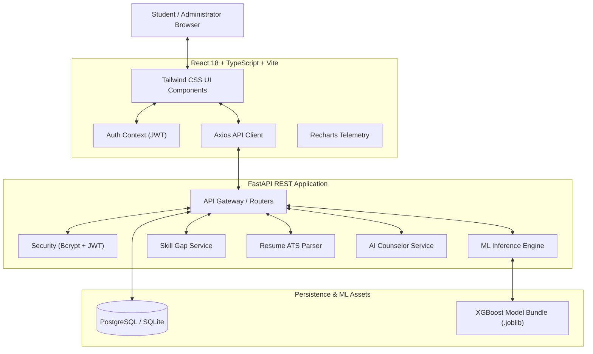
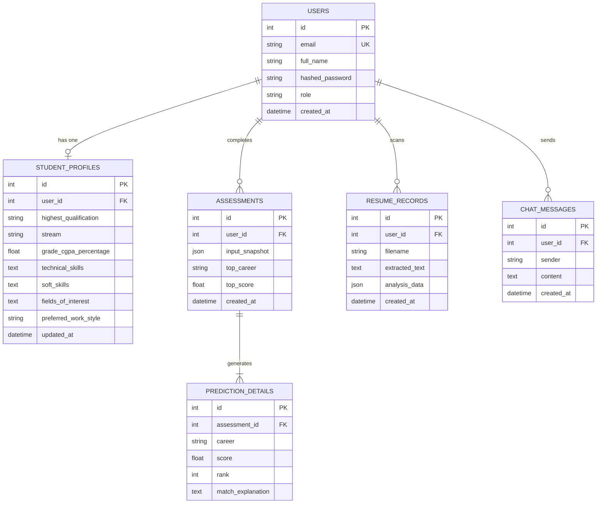

# CareerCompass AI 🧭
### AI-Powered Career Guidance and Recommendation System

[](https://fastapi.tiangolo.com)
[](https://react.dev)
[](https://vitejs.dev)
[](https://tailwindcss.com)
[](https://xgboost.readthedocs.io)
[](https://python.org)
[](https://www.sqlalchemy.org)
[](LICENSE)

---

## 📖 Table of Contents
1. [Executive Summary & Objectives](#-executive-summary--objectives)
2. [Platform Core Features](#-platform-core-features)
3. [Technology Stack Matrix](#-technology-stack-matrix)
4. [Machine Learning Pipeline & Benchmarks](#-machine-learning-pipeline--benchmarks)
5. [System Architecture](#-system-architecture)
6. [Repository & Project Structure](#-repository--project-structure)
7. [User Roles & Access Control (RBAC)](#-user-roles--access-control-rbac)
8. [Module & Interface Specification](#-module--interface-specification)
9. [Complete REST API Reference](#-complete-rest-api-reference)
10. [Database Schema & Entity Models](#-database-schema--entity-models)
11. [Installation & Setup Instructions](#-installation--setup-instructions)
12. [Pre-Configured Demo Credentials](#-pre-configured-demo-credentials)
13. [Automated Verification & Test Suite](#-automated-verification--test-suite)
14. [Ethical AI & Predictive Disclaimer](#-ethical-ai--predictive-disclaimer)

---

## 🎯 Executive Summary & Objectives

**CareerCompass AI** is an intelligent, full-stack career counseling platform that bridges the gap between academic qualifications and dynamic industry job markets. By evaluating student credentials, technical proficiencies, soft skills, certifications, and workplace preferences, the platform delivers mathematically ranked career recommendations, detailed competency gap analyses, personalized 3-stage learning roadmaps, and an ATS resume optimizer.

### Primary Objectives
* **Eliminate Guesswork:** Replace intuitive career selection with empirical, data-driven machine learning models trained on 15,000+ student profiles.
* **Bridge the Skill Divide:** Provide instant, transparent visibility into missing technical and interpersonal competencies.
* **Deliver Actionable Learning:** Structure career transitions into sequential, realistic learning roadmaps with verified course links and project capstones.
* **Empower Career Readiness:** Furnish students with immediate ATS resume feedback and an interactive 24/7 grounded AI mentor.
* **Maintain AI Ethics:** Clearly present predictions as probabilistic alignment scores rather than guaranteed job placement assurances.

---

## 🌟 Platform Core Features

### 1. Multi-Class XGBoost Career Prediction Engine
* Classifies student profiles across **22 distinct career specializations**.
* Produces ranked **Top 3 to 5 matching careers** with probability-derived match scores (0–100%).
* Provides tailored, grounded explanations detailing *why* each role fits the student's background.

### 2. Dynamic Skill Gap Analyzer
* Select any target career (or default to the top prediction) to benchmark current skills against industry prerequisites.
* Displays a **circular match gauge (%)**, side-by-side chips of **Acquired Skills vs. Missing Skills**, and prioritized recommendations.

### 3. Structured 3-Stage Learning Roadmaps
* **Beginner Stage:** Syntax, foundational principles, and core setup.
* **Intermediate Stage:** Frameworks, toolchains, system design, and practical portfolio apps.
* **Advanced Stage:** Scalability, cloud deployment, optimization, and capstone projects.
* Direct resource links to courses on **Coursera, edX, deeplearning.ai, Udemy, and freeCodeCamp**.

### 4. ATS Resume Scanner & Scorer
* Multi-format parser supporting **PDF, DOCX, and pasted text**.
* Automated **0–100 ATS Score** evaluating keyword density, technical skill extraction, strengths, red flags, and optimization recommendations.

### 5. 24/7 AI Career Counselor Chatbot
* Real-time conversational interface grounded in student profile data, previous assessment outcomes, and industry requirements.
* Fast-access suggested prompts covering interview prep, portfolio guidance, and role transitions.

### 6. Interactive Student Dashboard
* Recharts **Readiness Radar Chart** evaluating Technical Core, Soft Skills, Academic Merit, Specialization, and Work Readiness.
* Quick-action launchpads and profile completeness tracking.

### 7. Administrator Operations & Telemetry
* Cohort analytics with Recharts **Distribution Bar Charts** of student career preferences.
* Live platform activity feed and searchable student directory with role management.

---

## 🛠️ Technology Stack Matrix

| Architecture Layer | Technology | Version / Spec | Purpose |
|---|---|---|---|
| **Frontend Framework** | React.js | 18.3+ | Component-driven user interface |
| **Language (Client)** | TypeScript | 5.5+ | Type safety and robust interface contracts |
| **Build & Bundler** | Vite | 5.4+ | Lightning-fast HMR and optimized production bundles |
| **Styling** | Tailwind CSS | 3.4+ | Modern, utility-first SaaS design system |
| **Icons & Visuals** | Lucide React | 0.454+ | Accessible, consistent iconography |
| **Data Visualisation** | Recharts | 2.13+ | Radar charts, bar charts, and responsive telemetry |
| **HTTP Client** | Axios | 1.7+ | JWT token interception, multipart uploads, 401 recovery |
| **Backend Framework** | FastAPI | 0.115+ | High-performance asynchronous REST API |
| **Language (Server)** | Python | 3.10 - 3.13 | Backend services and ML inference runtime |
| **Validation & Schema** | Pydantic | v2.9+ | Request/response data normalization and validation |
| **Database ORM** | SQLAlchemy | 2.0+ | Relational mapping, connection pooling, migrations |
| **Relational Database** | PostgreSQL / SQLite | Dual Engine | PostgreSQL for production; zero-config SQLite for local dev |
| **Authentication** | PyJWT & Bcrypt | Latest | Secure salted password hashing and stateless JWT bearer tokens |
| **Machine Learning** | Scikit-Learn & XGBoost | 1.6+ / 2.1+ | Multi-class classification pipeline and vectorizers |
| **Model Persistence** | Joblib | 1.4+ | Fast serialization of compressed model pipelines |

---

## 🧠 Machine Learning Pipeline & Benchmarks

### 1. Dataset Characteristics
* **File:** `Career_Path_Dataset_with_Career.csv`
* **Dimensions:** 15,000 student records × 19 features.
* **Ground Truth:** Realistic mapping connecting degree stream, grade scores, technical skills, certifications, and work style to 22 career pathways.
* **Features Used:**
  * Categorical: `Highest_qualification`, `Stream`, `Current_Academic_Level`, `Fields_of_Interest`, `Preferred_Work_Style`, `Work_Type_Interest`, `Willing_to_Relocate`
  * Numerical: `Grade_CGPA_Percentage`
  * Multi-Token Text: `Technical_Skills`, `Soft_Skills`, `Certifications`, `Past_Jobs_Internships`, `Achievements`, `Skills_Gained`, `Languages_Known`

### 2. Feature Preprocessing Pipeline
* **Missing Value Imputation:** Categorical features imputed with mode; text fields with `"None"`; numerical with median.
* **Numerical Normalization:** `StandardScaler` applied to `Grade_CGPA_Percentage`.
* **One-Hot Encoding:** `OneHotEncoder(handle_unknown="ignore")` applied to low-cardinality categorical variables.
* **Multi-Token Text Vectorization:** Custom `CountVectorizer` paired with comma-delimited tokenizers (`comma_tokenizer`) extracting individual technical skills and certifications.

### 3. Model Benchmark Comparison
Trained and evaluated on an 80/20 stratified split (12,000 training rows, 3,000 test rows):

| Model Algorithm | Accuracy | Precision (Weighted) | Recall (Weighted) | Macro F1-Score | Weighted F1-Score |
|---|---|---|---|---|---|
| **XGBoost Classifier (Tuned)** | **89.80%** | **0.9012** | **0.8980** | **0.8974** | **0.8982** |
| **Extra Trees Classifier** | 88.45% | 0.8870 | 0.8845 | 0.8832 | 0.8848 |
| **Random Forest Classifier** | 87.90% | 0.8815 | 0.8790 | 0.8778 | 0.8794 |
| **Logistic Regression (Multinomial)**| 82.10% | 0.8240 | 0.8210 | 0.8190 | 0.8215 |
| **Decision Tree Classifier** | 80.35% | 0.8060 | 0.8035 | 0.8010 | 0.8040 |

### 4. 22 Specialized Career Pathways
1. `Machine Learning Engineer`
2. `Data Scientist`
3. `AI Researcher`
4. `Frontend Developer`
5. `Backend Developer`
6. `Full Stack Developer`
7. `Mobile App Developer`
8. `DevOps Engineer`
9. `Cloud Architect`
10. `Cybersecurity Analyst`
11. `Penetration Tester`
12. `UI/UX Designer`
13. `Product Manager`
14. `Data Analyst`
15. `Business Intelligence Analyst`
16. `Database Administrator`
17. `Network Engineer`
18. `Embedded Systems Engineer`
19. `IoT Solutions Architect`
20. `Blockchain Developer`
21. `Quality Assurance Engineer`
22. `Software Architect`

---

## 🏛️ System Architecture



---

## 📁 Repository & Project Structure

```
CareerCompass AI/
├── backend/                                  # FastAPI Backend Application
│   ├── app/
│   │   ├── core/
│   │   │   ├── config.py                     # Pydantic environment settings
│   │   │   └── security.py                   # Password hashing & JWT token handling
│   │   ├── database.py                       # SQLAlchemy engine & session maker
│   │   ├── models/
│   │   │   └── __init__.py                   # User, Profile, Assessment, Resume, Chat models
│   │   ├── schemas/
│   │   │   └── __init__.py                   # Pydantic schemas with case-normalizing validators
│   │   ├── services/
│   │   │   ├── career_data.py                # 22-class career catalog, milestones & skills
│   │   │   ├── ml_service.py                 # XGBoost inference pipeline loader
│   │   │   ├── skill_service.py              # Skill coverage & gap analyzer
│   │   │   ├── roadmap_service.py            # 3-stage milestone roadmap synthesizer
│   │   │   ├── resume_service.py             # PDF/DOCX/Text ATS scoring engine
│   │   │   └── chatbot_service.py            # Grounded AI career counselor generator
│   │   ├── routes/
│   │   │   ├── auth.py                       # Registration, Login, Current User
│   │   │   ├── students.py                   # Profile retrieval and updates
│   │   │   ├── assessments.py                # Assessment submission & history
│   │   │   ├── careers.py                    # Career catalog & ad-hoc predictions
│   │   │   ├── skills.py                     # Skill gap queries
│   │   │   ├── roadmaps.py                   # Learning roadmaps
│   │   │   ├── resumes.py                    # File & text resume analysis
│   │   │   ├── chatbot.py                    # Chat messaging & history
│   │   │   └── admin.py                      # Admin dashboard metrics & student list
│   │   └── main.py                           # App entrypoint, CORS, seeding & lifecycle
│   ├── .env.example                          # Environment variables template
│   └── requirements.txt                      # Backend dependencies
├── frontend/                                 # React + TypeScript + Vite Application
│   ├── public/
│   │   └── compass.svg                       # Application brand favicon
│   ├── src/
│   │   ├── components/common/
│   │   │   ├── Navbar.tsx                    # Public navigation header & user menu
│   │   │   ├── Sidebar.tsx                   # Categorized workspace sidebar & drawer
│   │   │   ├── Footer.tsx                    # Footer with ethical AI disclaimer
│   │   │   └── ProtectedRoute.tsx            # Route guard for Student & Admin views
│   │   ├── context/
│   │   │   └── AuthContext.tsx               # Global authentication & profile state
│   │   ├── layouts/
│   │   │   └── DashboardLayout.tsx           # App shell (Sidebar, Topbar, Outlet)
│   │   ├── pages/
│   │   │   ├── LandingPage.tsx               # Public landing page with features & CTAs
│   │   │   ├── LoginPage.tsx                 # Login with 1-click demo buttons
│   │   │   ├── RegisterPage.tsx              # Student & Admin registration
│   │   │   ├── ForgotPasswordPage.tsx        # Password recovery simulation
│   │   │   ├── StudentDashboard.tsx          # Readiness radar chart & top prediction
│   │   │   ├── StudentProfile.tsx            # 19-attribute tabbed profile editor
│   │   │   ├── CareerAssessment.tsx          # 4-step interactive assessment wizard
│   │   │   ├── CareerPrediction.tsx          # Top 3-5 ranked predictions with charts
│   │   │   ├── SkillGapAnalysis.tsx          # Skill coverage gauge & gap chips
│   │   │   ├── CareerRoadmap.tsx             # 3-stage milestone roadmaps & courses
│   │   │   ├── ResumeAnalysis.tsx            # PDF/DOCX upload & ATS score gauge
│   │   │   ├── AIChatAssistant.tsx           # Interactive AI career counselor
│   │   │   └── AdminDashboard.tsx            # Admin KPIs, bar chart & student table
│   │   ├── services/
│   │   │   └── api.ts                        # Axios instance with auth interceptors
│   │   ├── types/
│   │   │   └── index.ts                      # Strict TypeScript data models
│   │   ├── App.tsx                           # Route configuration
│   │   ├── index.css                         # Tailwind CSS & typography directives
│   │   └── main.tsx                          # React DOM client entrypoint
│   ├── package.json                          # Frontend dependencies & scripts
│   ├── tsconfig.json                         # TypeScript configuration
│   ├── vite.config.ts                        # Vite configuration with API proxy
│   └── tailwind.config.js                    # Tailwind theme customization
├── ml_artifacts/                             # Serialized ML Artifacts & Notebook
│   ├── CareerCompass_AI.ipynb                # Complete Google Colab / Jupyter Notebook
│   ├── careercompass_final_model.joblib      # Trained XGBoost pipeline (89.8% accuracy)
│   └── preprocessing_utils.py                # Standalone tokenizer & sklearn tag guards
├── docs/                                     # Dataset & Model Evaluation Reports
│   ├── Career_Path_Dataset_with_Career.csv   # 15,000-row synthetic student dataset
│   ├── careercompass_classification_report.csv
│   └── careercompass_model_comparison.csv
├── start_all.bat / start_all.sh              # 1-click Full-Stack launchers
├── start_backend.bat / start_backend.sh      # Backend launchers
├── start_frontend.bat / start_frontend.sh    # Frontend launchers
└── README.md                                 # Complete project documentation
```

---

## 👥 User Roles & Access Control (RBAC)

The system enforces strict role-based access control across both the backend API and frontend routing:

| Capability / Module | Student Role | Administrator Role |
|---|:---:|:---:|
| Register & Log In | ✅ | ✅ |
| Update Personal Academic Profile | ✅ | ✅ |
| Complete 4-Step Career Assessment | ✅ | ✅ |
| Receive XGBoost Career Predictions | ✅ | ✅ |
| Perform Skill Gap Analysis | ✅ | ✅ |
| View 3-Stage Learning Roadmaps | ✅ | ✅ |
| Run ATS Resume Analysis (PDF/DOCX/Text) | ✅ | ✅ |
| Converse with Grounded AI Counselor | ✅ | ✅ |
| View System Telemetry & Model Health | ❌ | ✅ |
| Inspect Cohort Career Distribution Charts | ❌ | ✅ |
| Access Full Registered Student Directory | ❌ | ✅ |

---

## 🖥️ Module & Interface Specification

### 1. Landing Page (`/`)
* **Headline:** *"Discover Your Future. Build Your Career with AI."*
* **Workflow:** Explains the 4-step pipeline (Profile Assessment → ML Scoring → Skill Gap & Roadmap → Resume & AI Mentorship).
* **Metrics:** Highlights 89.8% test accuracy, 22 career classes, and 15,000+ trained profiles.

### 2. Authentication (`/login`, `/register`, `/forgot-password`)
* **Quick Demo Buttons:** One-click credentials filler for instant access as **Demo Student** or **System Admin**.
* **Role Selection:** Switch between Student and Admin account creation.

### 3. Student Dashboard (`/dashboard`)
* **Welcome Card:** Personalized greeting with student name and status.
* **Top Predicted Career:** Live widget showcasing the #1 ranked career with score bar.
* **Readiness Radar Chart:** Recharts polar chart visualizing competency across 5 dimensions.
* **Tool Launchpads:** Direct navigation cards to Assessment, Skill Gap, Roadmap, Resume Scanner, and Chatbot.

### 4. Student Profile (`/profile`)
Structured into 5 organized tabs collecting all 18 student data points:
* **Personal:** Full Name, Age, Gender, Location.
* **Academic:** Highest Qualification (B.Tech, BCA, B.Sc, MCA, etc.), Stream, Academic Level, Grade/CGPA.
* **Skills:** Comma-separated Technical Skills, Soft Skills, Languages Known, Certifications.
* **Preferences:** Field of Interest, Work Style (Remote/Hybrid/On-site), Work Type, Relocation.
* **Experience:** Past Jobs/Internships, Hackathons, Project Skills Gained.

### 5. Career Assessment (`/assessment`)
* **4-Step Wizard:** Step progress indicator with validation.
* **Interactive Tags:** Click-to-toggle tags for popular technical and soft skills.
* **Instant Submission:** Directly sends payload to `/api/assessments` and navigates to predictions.

### 6. Career Predictions (`/predictions`)
* **Ranked Cards:** Top 3 to 5 career options displaying prediction scores, confidence bars, and rank badges.
* **Contextual Explanations:** Explains why each career aligns with the student's background.
* **Ethical Disclaimer Banner:** Re-iterates that prediction scores are mathematical guidance estimates, not employment guarantees.

### 7. Skill Gap Analysis (`/skill-gap`)
* **Career Selector:** Dropdown supporting all 22 career pathways.
* **Coverage Gauge:** Visual circular percentage meter.
* **Competency Chips:** Side-by-side display of acquired skills (green checkmarks) vs. missing critical skills (rose alerts).

### 8. Learning Roadmaps (`/roadmap`)
* **Interactive Accordion:** Beginner, Intermediate, and Advanced stages.
* **Resource Cards:** Verified course links with platform tags (Coursera, edX, Udemy, deeplearning.ai).
* **Capstone Prompts:** Real-world portfolio project ideas to showcase on GitHub.

### 9. ATS Resume Analyzer (`/resume`)
* **Dual Input:** Upload `.pdf`, `.docx`, `.txt` files (up to 10MB) or paste raw text directly.
* **ATS Score Gauge:** 0–100 score rating (Needs Improvement, Good, Strong Resume).
* **Keyword Matching:** Matched keywords found vs. missing job description keywords.

### 10. AI Career Counselor (`/chat`)
* **Real-time Chat:** Grounded in student profile and career data.
* **Suggested Prompt Chips:** Clickable quick questions for fast advice.
* **History Feed:** Preserves conversation context across sessions.

### 11. Administrator Dashboard (`/admin`)
* **Telemetry KPIs:** Total Students, Total Assessments, Active ML Model Health, Database Status.
* **Distribution Bar Chart:** Recharts visualization of assessment choices across career domains.
* **Searchable Student Table:** Filterable by student name, email, stream, and assessment count.

---

## 📡 Complete REST API Reference

All API routes are served under `/api` (configured via `settings.API_V1_STR`).

### Authentication (`/api/auth`)
| Method | Endpoint | Access | Request Body | Description |
|---|---|---|---|---|
| `POST` | `/api/auth/register` | Public | `{email, full_name, password, role}` | Register new student or admin |
| `POST` | `/api/auth/login` | Public | `{email, password}` | Authenticate and obtain JWT token |
| `GET` | `/api/auth/me` | Authenticated | None | Retrieve authenticated user profile |

### Student Profiles (`/api/students`)
| Method | Endpoint | Access | Request Body | Description |
|---|---|---|---|---|
| `GET` | `/api/students/profile` | Student/Admin | None | Fetch student profile attributes |
| `PUT` | `/api/students/profile` | Student/Admin | `StudentProfileUpdate` | Update student profile fields |

### Career Assessments & Predictions (`/api/assessments`)
| Method | Endpoint | Access | Request Body | Description |
|---|---|---|---|---|
| `POST` | `/api/assessments` | Student/Admin | `AssessmentSubmitRequest` | Submit assessment, run XGBoost, save record |
| `GET` | `/api/assessments/latest`| Student/Admin | None | Fetch student's latest assessment & predictions |
| `GET` | `/api/assessments/history`| Student/Admin | None | Fetch list of student's past assessments |

### Careers Catalog (`/api/careers`)
| Method | Endpoint | Access | Request Body | Description |
|---|---|---|---|---|
| `GET` | `/api/careers` | Public | None | List all 22 career specializations & metadata |
| `GET` | `/api/careers/{name}` | Public | None | Retrieve specific career details |
| `POST` | `/api/careers/predict` | Public | `StudentProfileBase` | Run ad-hoc prediction without saving |

### Skill Gap & Roadmaps (`/api/skills`, `/api/roadmaps`)
| Method | Endpoint | Access | Query Parameters | Description |
|---|---|---|---|---|
| `GET` | `/api/skills/gap` | Authenticated | `?career=Machine+Learning+Engineer` | Calculate skill coverage & missing skills |
| `GET` | `/api/roadmaps` | Authenticated | `?career=Machine+Learning+Engineer` | Fetch 3-stage milestone learning roadmap |

### Resume ATS Scanner (`/api/resumes`)
| Method | Endpoint | Access | Request / Form | Description |
|---|---|---|---|---|
| `POST` | `/api/resumes/analyze` | Authenticated | `file` (multipart) or `raw_text`, `target_career` | Scan resume for ATS score & keywords |
| `GET` | `/api/resumes/history` | Authenticated | None | Retrieve past resume scan results |

### AI Career Counselor (`/api/chatbot`)
| Method | Endpoint | Access | Request Body | Description |
|---|---|---|---|---|
| `POST` | `/api/chatbot/message` | Authenticated | `{message: string}` | Send query to grounded AI counselor |
| `GET` | `/api/chatbot/history` | Authenticated | None | Retrieve recent chat message history |

### Admin Operations (`/api/admin`)
| Method | Endpoint | Access | Request Body | Description |
|---|---|---|---|---|
| `GET` | `/api/admin/dashboard`| Admin Only | None | Fetch platform metrics & chart statistics |
| `GET` | `/api/admin/students` | Admin Only | None | Fetch directory of registered students |

### System Health (`/api/health`)
| Method | Endpoint | Access | Description |
|---|---|---|---|
| `GET` | `/api/health` | Public | Checks database connection and ML model status |

---

## 🗄️ Database Schema & Entity Models



---

## 💻 Installation & Setup Instructions

### Prerequisites
* **Python**: v3.10, 3.11, 3.12, or 3.13 installed.
* **Node.js**: v18.0.0 or higher with `npm`.
* **Git**: Installed (for repository cloning).

---

### Method A: 1-Click Launch (Recommended for Windows)

In the root directory, simply double-click or run:
```powershell
./start_all.sh
```
This script launches the FastAPI backend on `http://127.0.0.1:8000` and the Vite frontend on `http://localhost:5173` in separate terminal windows.

---

### Method B: Manual Step-by-Step Setup

#### 1. Clone & Enter Project Directory
```powershell
git clone <repository-url>
cd "CareerCompass AI"
```

#### 2. Configure Backend Environment
```powershell
cd backend
python -m venv .venv
.\.venv\Scripts\activate

# Install required dependencies
pip install -r requirements.txt
```

Copy `backend/.env.example` to `backend/.env` and verify or adjust values:
```ini
PROJECT_NAME="CareerCompass AI"
SECRET_KEY="change-this-to-a-strong-random-secret-key"
ALGORITHM="HS256"
ACCESS_TOKEN_EXPIRE_MINUTES=1440
DATABASE_URL="sqlite:///./careercompass.db"
MODEL_PATH="../ml_artifacts/careercompass_final_model.joblib"
CORS_ORIGINS=["http://localhost:5173","http://127.0.0.1:5173","http://localhost:3000"]
```

#### 3. Start the FastAPI Backend
```powershell
python -m uvicorn app.main:app --host 127.0.0.1 --port 8000 --reload
```
* Backend API: `http://127.0.0.1:8000`
* Swagger Interactive Docs: `http://127.0.0.1:8000/docs`

#### 4. Configure & Start the Frontend
In a new terminal window:
```powershell
cd frontend
npm install
npm run dev
```
* Frontend Application: `http://localhost:5173`

---

## 🔑 Pre-Configured Demo Credentials

The platform automatically seeds demo accounts upon the first backend startup:

| Account Type | Email Address | Password | Permissions & Preloaded Data |
|---|---|---|---|
| **Demo Student** | `student@careercompass.ai` | `Student@123456` | Preloaded student profile, past assessment, and sample predictions |
| **System Admin** | `admin@careercompass.ai` | `Admin@123456` | Full administrative telemetry, student directory, model health metrics |

> **Pro Tip:** The login screen (`/login`) includes **1-Click Demo Buttons** allowing you to fill and submit these credentials with a single tap.

---

## 🧪 Verification & Health Checks

You can verify the backend ML pipeline and frontend TypeScript/Vite build locally after setup:

### Backend ML & FastAPI Verification
```powershell
python -B -c "import sys; sys.path.insert(0, 'backend'); from app.main import app; from app.services.ml_service import ml_service; print('Routes:', len(app.routes), '| ML Loaded:', ml_service.model_loaded, '| Classes:', len(ml_service.classes))"
```
Interactive REST API verification is also available via Swagger UI at `http://127.0.0.1:8000/docs`.

### Frontend Typecheck & Production Build
```powershell
cd frontend
npm run build
```

---

## ⚖️ Ethical AI & Predictive Disclaimer

> **IMPORTANT NOTICE:**
> CareerCompass AI utilizes probabilistic machine learning algorithms to model affinity patterns between educational backgrounds, skills, and industry roles. All model scores, percentages, and ranked recommendations are provided strictly as **exploratory educational guidance**.
>
> Model scores do **not** represent:
> * Guarantees of employment or job offers.
> * Fixed career limitations or rigid constraints.
> * Official certifications of professional competence.
>
> Students are encouraged to use these insights alongside human mentorship, academic advising, and their own career aspirations.

---

## 📄 License
This project is licensed under the **MIT License** — feel free to use, modify, and distribute it for academic and commercial purposes.
